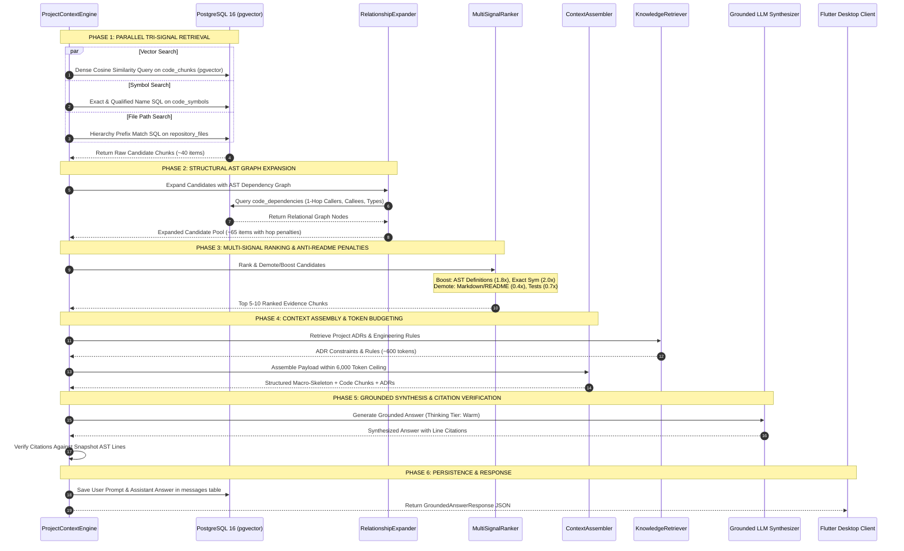

# Unotusk Post-Processing Data Pipeline Report

> **Authoritative Technical Specification: Post-Query-Decomposition Data Processing Lifecycle**  
> *Target Stack: FastAPI Async Backend (`apps/api/`) + PostgreSQL 16 (`pgvector`) + Tree-sitter AST Engines + Multi-Provider Grounded LLM*

---

## 1. Executive Overview

### The Boundary: Where Pre-Processing Ends & Post-Processing Begins

Before post-processing begins, the pre-processing phase has already completed:
1. **Request Authentication & Tenant Scoping**: Verified Bearer JWT, resolved `user_id`, `project_id`, and active `organization_id`.
2. **Snapshot & Branch Resolution**: Resolved `payload.branch` (e.g., `features`, `checkout`) to a specific `RepositorySnapshot` record, isolating feature branch commits from `main`.
3. **Query Decomposition (`analyze_query_async`)**: Parsed raw natural language to extract:
   - **Target Symbols**: `['PaymentGateway', 'handle_event', 'IdempotencyKeyStore']`
   - **File Path Clues**: `['src/billing', '.py']`
   - **Concept Synonyms**: `['webhook', 'duplicate', 'retry', 'idempotency']`
   - **Temporal Intent**: `False` (standard code inquiry, not a git log comparison)


Once pre-processing produces the decomposed `AnalyzedQuery` object, the system initiates the **Post-Processing Pipeline**.

---

## 2. Comprehensive Post-Processing Flowchart



---

## 3. Phase 1: Parallel Tri-Signal Candidate Retrieval

Rather than relying solely on semantic embedding similarity, post-processing executes **three parallel database lookups** to balance semantic concept matching with lexical and symbol precision:

### Signal 1: Dense Vector Cosine Search (pgvector)
Queries the vector embeddings of source code chunks:
```sql
SELECT 
    c.id,
    c.file_path,
    c.start_line,
    c.end_line,
    c.content,
    c.symbol_type,
    1 - (c.embedding <=> :query_vector) AS cosine_similarity
FROM code_chunks c
JOIN repository_files f ON f.id = c.file_id
WHERE f.snapshot_id = :active_snapshot_id
ORDER BY c.embedding <=> :query_vector ASC
LIMIT 40;
```

### Signal 2: AST Code Symbol Matching
Matches exact or prefix declarations of classes, functions, and interfaces identified by Tree-sitter:
```sql
SELECT 
    s.id,
    s.name,
    s.qualified_name,
    s.symbol_type,
    s.file_id,
    s.start_line,
    s.end_line
FROM code_symbols s
JOIN repository_files f ON f.id = s.file_id
WHERE f.snapshot_id = :active_snapshot_id
  AND (s.name ILIKE ANY(:target_symbols) OR s.qualified_name ILIKE ANY(:target_symbols))
LIMIT 25;
```

### Signal 3: File Path Prefix Matching
Resolves directory and file path clues:
```sql
SELECT 
    f.id,
    f.path,
    f.language
FROM repository_files f
WHERE f.snapshot_id = :active_snapshot_id
  AND (f.path ILIKE ANY(:path_prefixes))
LIMIT 20;
```

---

## 4. Phase 2: Structural AST Graph Expansion

A critical limitation of basic RAG systems is returning an isolated snippet of code without the methods it invokes or the callers that depend on it. Post-processing invokes `RelationshipExpander` to perform a bounded Breadth-First Search (BFS) over the `code_dependencies` table:

```
[Target Symbol] ──(calls)─────────► [Callee Symbol] (1-Hop Outbound: 0.85x)
       ▲
       │──(called by)───── [Caller Route] (1-Hop Inbound: 0.85x)
       │
       └──(parameter type)─► [Schema / Struct] (Type Resolution: 0.90x)
```

1. **1-Hop Inbound Callers**: Discovers who executes this code (e.g., finding the HTTP controller that invokes the payment service).
2. **1-Hop Outbound Callees**: Discovers downstream dependencies (e.g., finding the database repository or Stripe SDK invoked by the service).
3. **Type Definitions**: Resolves domain models, interfaces, and DTOs used in signatures.
4. **Hop Distance Attenuation**:
   - Depth 0 (Direct Match): `Relevance = 1.0x`
   - Depth 1 (Direct Neighbor): `Relevance = 0.85x`
   - Depth 2 (Transitive Neighbor): `Relevance = 0.60x`
   - Depth > 2: Pruned to prevent context contamination.

---

## 5. Phase 3: Multi-Signal Ranking & Anti-README Bias Engine

In standard code retrieval, `README.md` and documentation files frequently outrank actual code because documentation uses the exact natural language words present in user questions. 

Unotusk's `MultiSignalRanker` neutralizes this through a mathematical scoring model:

### The Scoring Equation
$$\text{Base Score} = (S_{\text{lexical}} \cdot W_{\text{lex}}) + (S_{\text{vector}} \cdot W_{\text{vec}}) + (S_{\text{symbol}} \cdot W_{\text{sym}})$$
$$\text{Final Score} = \text{Base Score} \cdot M_{\text{AST Boost}} \cdot M_{\text{README Demotion}} \cdot M_{\text{Exact Match}} \cdot M_{\text{Test Demotion}}$$

### Multiplier Breakdown

| Multiplier Rule | Factor | Trigger Condition | Rationale |
| :--- | :---: | :--- | :--- |
| **AST Code Definition Boost** | **`1.8x`** | Chunk defines `CLASS`, `METHOD`, `FUNCTION`, `INTERFACE`, or `STRUCT` | Prioritizes executable logic over comments and text. |
| **Markdown / README Demotion** | **`0.4x`** | File matches `.md`, `.rst`, `README`, or `docs/` and query does NOT explicitly ask for docs | Eliminates superficial documentation hits for implementation queries. |
| **Exact Symbol Multiplier** | **`2.0x`** | Chunk definition matches the exact queried identifier (e.g. `PaymentGateway`) | Ensures requested classes are at the top of the evidence list. |
| **Test & Mock File Demotion** | **`0.7x`** | File path contains `tests/`, `test/`, or `__tests__/` | Keeps test boilerplate from cluttering architectural analysis. |

---

## 6. Phase 4: Context Assembly & Dynamic Token Budgeting

Once the candidate set is ranked, the top 5–10 items are passed to `ContextAssembler`. The assembler enforces a strict **6,000 token ceiling** to prevent prompt dilution and guarantee that high-priority code fits within LLM context windows:

```
┌─────────────────────────────────────────────────────────────────────────┐
│               TOTAL CONTEXT BUDGET CEILING: 6,000 TOKENS                │
├────────────────────────────────┬──────────────┬─────────────────────────┤
│ Context Layer                  │ Token Quota  │ Contents                │
├────────────────────────────────┼──────────────┼─────────────────────────┤
│ 1. Macro Repository Skeleton   │ ~800 tokens  │ Directory tree, major   │
│                                │              │ services, architecture  │
├────────────────────────────────┼──────────────┼─────────────────────────┤
│ 2. Ranked Code Evidence Chunks │ ~3,800 tokens│ Top 5-10 AST chunks with│
│                                │              │ exact file & line bounds│
├────────────────────────────────┼──────────────┼─────────────────────────┤
│ 3. Team ADRs & Constraints     │ ~600 tokens  │ Architectural decisions │
│                                │              │ & engineering rules     │
├────────────────────────────────┼──────────────┼─────────────────────────┤
│ 4. Conversation History        │ ~800 tokens  │ Previous user & model   │
│                                │              │ turns in this thread    │
└────────────────────────────────┴──────────────┴─────────────────────────┘
```

If the payload exceeds 6,000 tokens:
1. Low-scoring chunks at the bottom of the evidence list are pruned first.
2. Long function bodies are truncated to signatures and key control flow branches.
3. Macro-skeleton and ADR constraints are preserved.

---

## 7. Phase 5: Grounded LLM Synthesis & Verification

The assembled payload is formatted into system and user prompts and dispatched to the active LLM synthesizer (Groq Qwen/Llama or Claude 3.5 Sonnet) configured according to the user's selected **Thinking Tier**:

- **Hot Tier (`low` reasoning effort)**: Optimized for fast, immediate syntax and reference questions (< 2 seconds).
- **Warm Tier (`medium` reasoning effort)**: Default balanced analysis; traverses dependencies and validates design patterns.
- **Cold Tier (`high` reasoning effort)**: Deep architectural audits, cross-service risk analysis, and migration planning.

### Post-Synthesis Verification Gate
Before any generated text is returned to the user, the backend executes an automated citation verification check:
1. **Citation Extraction**: Regex parses all markdown citations (e.g. `src/billing/gateway.py#L45-L78`).
2. **AST Verification**: Checks whether `src/billing/gateway.py` exists in the active `RepositorySnapshot` and that lines 45–78 correspond to the cited function.
3. **Anti-Hallucination Scrub**: If a cited line range or file does not exist in the snapshot, the citation is removed or flagged as ungrounded before delivery.

---

## 8. Phase 6: Persistence & Client Delivery

The final stage persists the interaction state to maintain multi-user, cross-session isolation:

1. **Thread State Persistence**:
   - Inserts the user prompt into the `messages` table with role `USER`.
   - Inserts the assistant reply into `messages` with role `ASSISTANT`, storing `evidence_items`, `debug_signals`, and `thinking_tier`.
   - Updates `conversations.updated_at`.
2. **Client JSON Delivery**:
   - Returns a structured `GroundedAnswerResponse` containing:
     - `answer`: Grounded explanation formatted in GitHub-style Markdown.
     - `evidence`: List of cited files, start/end lines, symbol types, and relevance scores.
     - `related_entities`: List of discovered callers, callees, and dependencies.
     - `debug_signals`: Query execution time, ranker multiplier telemetry, and thinking tier details.

---

## 9. End-to-End Concrete Trace: Real Query Walkthrough

### User Prompt:
> *"How does webhook event deduplication work on the `features` branch?"*

```
[1. PRE-PROCESSING COMPLETE]
    • Query: "How does webhook event deduplication work on the features branch?"
    • Extracted Symbols: ['WebhookHandler', 'deduplicate', 'IdempotencyKeyStore']
    • Scoped Snapshot: snap-features-v4 (Branch: 'features', Commit: 7a8f9c2)

[2. PHASE 1: RETRIEVAL]
    • Vector Search: Retrieved 34 chunks via cosine distance.
    • Symbol SQL: Matched 'WebhookHandler' in src/billing/webhook.py.
    • Path SQL: Matched src/billing/.

[3. PHASE 2: GRAPH EXPANSION]
    • Target: WebhookHandler.handle_event (src/billing/webhook.py)
    • Inbound Caller: routes/billing.py::stripe_webhook_endpoint (Depth 1, 0.85x)
    • Outbound Callee: services/idempotency.py::IdempotencyKeyStore (Depth 1, 0.85x)

[4. PHASE 3: MULTI-SIGNAL RANKING]
    • Candidate A: src/billing/webhook.py (handle_event)
      Base Score: 2.45 | AST Boost: 1.8x | Exact Match: 2.0x -> FINAL: 8.82 (Rank #1)
    • Candidate B: services/idempotency.py (check_key)
      Base Score: 1.95 | AST Boost: 1.8x | Graph Callee: 0.85x -> FINAL: 2.98 (Rank #2)
    • Candidate C: docs/billing_guide.md
      Base Score: 2.20 | README Demotion: 0.4x -> FINAL: 0.88 (Rank #14 - Filtered Out)

[5. PHASE 4: CONTEXT ASSEMBLY]
    • Macro Skeleton: 640 tokens
    • Top Evidence Chunks (A + B): 3,120 tokens
    • ADR-004 (Idempotency Constraints): 410 tokens
    • Total Prompt Payload: 4,170 tokens (within 6,000 budget)

[6. PHASE 5: SYNTHESIS & VERIFICATION]
    • LLM Output generated citing src/billing/webhook.py#L42-L68 and services/idempotency.py#L15-L35.
    • Verification check: Both file paths and line ranges match snapshot snap-features-v4.
    • Grounding status: 100% verified.

[7. PHASE 6: DELIVERY]
    • Response rendered in Flutter Desktop Client AskTab with interactive code chips.
```

---

## 10. File & Codebase Reference Guide

All post-processing stages are fully implemented in the following codebase files:

- **Parallel Retrieval & Orchestration**: [ProjectContextEngine](file:///Users/mohanamahadevaiah/install-unotusk/apps/api/src/services/context_engine/engine.py)
- **Structural AST Graph Expansion**: [RelationshipExpander](file:///Users/mohanamahadevaiah/install-unotusk/apps/api/src/services/context_engine/graph_expander.py)
- **Scoring & Multipliers (Anti-README)**: [MultiSignalRanker](file:///Users/mohanamahadevaiah/install-unotusk/apps/api/src/services/context_engine/ranker.py)
- **Token Budgeting & Prompt Layout**: [ContextAssembler](file:///Users/mohanamahadevaiah/install-unotusk/apps/api/src/services/context_engine/assembler.py)
- **Team ADRs & Constraint Retrieval**: [KnowledgeRetriever](file:///Users/mohanamahadevaiah/install-unotusk/apps/api/src/services/knowledge_service.py)
- **LLM Grounded Synthesis Providers**: [Groq Provider](file:///Users/mohanamahadevaiah/install-unotusk/apps/api/src/services/llm/groq.py) & [Claude Provider](file:///Users/mohanamahadevaiah/install-unotusk/apps/api/src/services/llm/claude.py)
- **Desktop Client Integration**: [ApiService](file:///Users/mohanamahadevaiah/install-unotusk/app/lib/services/api_service.dart) & [WorkspaceRepository](file:///Users/mohanamahadevaiah/install-unotusk/app/lib/features/workspace/data/workspace_repository.dart)
