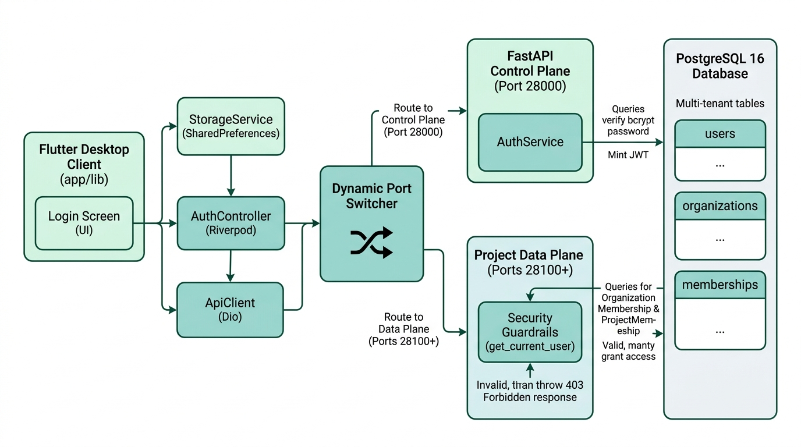
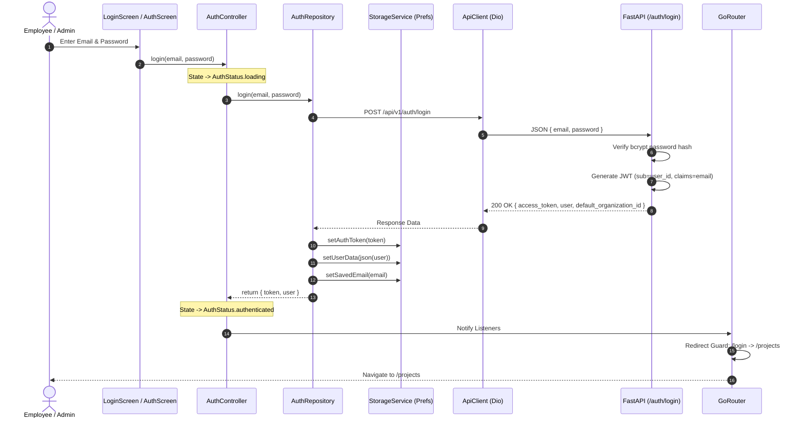
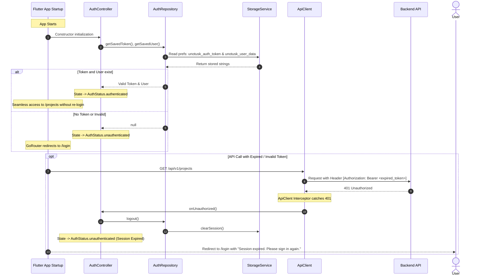
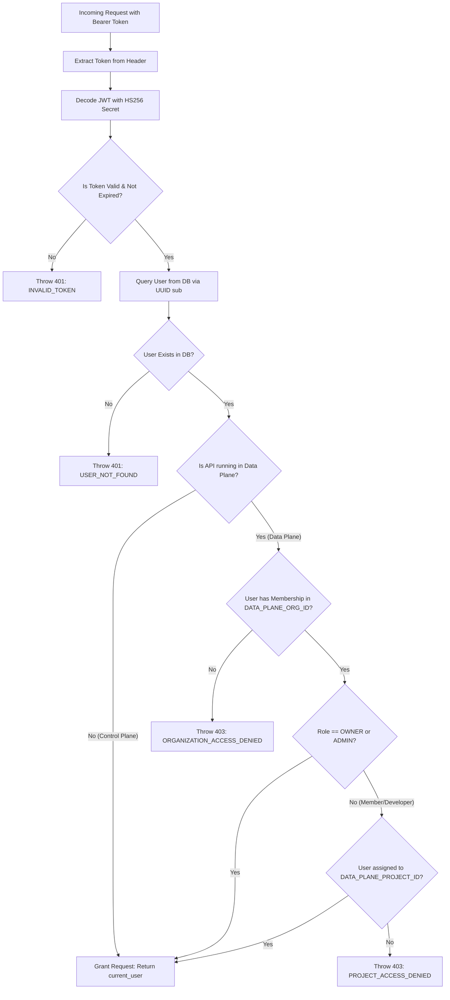

# Unotusk Authentication Service Architecture & Implementation Guide

This document provides a comprehensive overview of the **Authentication & Authorization Service** implemented in the `unotusk_flutter_app` ecosystem, covering both the **Flutter Desktop/Web Client** and the **FastAPI Backend Control/Data Plane**.

---

## 1. Actual Implemented Authentication Architecture

### 1.1 Layer-by-Layer Implementation Audit

| Layer / Component | In Conceptual Diagram | Truly Implemented in App? | Reality & Codebase Location |
| :--- | :---: | :---: | :--- |
| **Ingress: Desktop App (GUI)** | Yes | ✅ **YES** | Native Flutter Desktop app targeting Linux, Windows, macOS ([`app/lib/`](file:///c:/Users/sindk/OneDrive/Desktop/antigravity%20webs/unotusk_flutter_app/app/lib/)). Also Server Setup wizard ([`setup_app/lib/`](file:///c:/Users/sindk/OneDrive/Desktop/antigravity%20webs/unotusk_flutter_app/setup_app/lib/)). |
| **Ingress: Web Client (SPA)** | Yes | ❌ **NO** | There is **no SPA** (React/Vue/Angular or dedicated Web SPA). While Flutter generates default web scaffolding in `app/web/`, the app is built and tested purely as a desktop app. |
| **Ingress: CLI (Terminal)** | Yes | ❌ **NO** | There is **no user CLI tool** (no `unotusk` terminal command). The only scripts in `scripts/` are internal python DevOps/admin scripts (`clean_server_reset.py`, `verify_lan_connectivity.py`). |
| **Ingress: Reverse Proxy (Nginx)**| Yes | ❌ **NO** | No Nginx container or config exists. Clients communicate directly over HTTP/TLS to FastAPI. |
| **Ingress: API Gateway** | Yes | ❌ **NO** | No external API Gateway (Kong, Traefik, Envoy). FastAPI directly handles all routing. |
| **Dynamic Port Switcher** | Middlebox | ⚠️ **Client Logic Only** | Not a network middlebox. It is **pure Dart code** inside [`ApiClient`](file:///c:/Users/sindk/OneDrive/Desktop/antigravity%20webs/unotusk_flutter_app/app/lib/core/network/api_client.dart) switching between port 28000 and 28100+. |
| **Client: Presentation Tier** | Yes | ✅ **YES** | [`LoginScreen`](file:///c:/Users/sindk/OneDrive/Desktop/antigravity%20webs/unotusk_flutter_app/app/lib/features/auth/presentation/login_screen.dart) for authentication UI. |
| **Client: State Controller Tier** | Yes | ✅ **YES** | [`AuthController`](file:///c:/Users/sindk/OneDrive/Desktop/antigravity%20webs/unotusk_flutter_app/app/lib/features/auth/presentation/auth_controller.dart) via Riverpod `StateNotifier`. |
| **Client: Data Storage Tier** | Yes | ✅ **YES** | [`StorageService`](file:///c:/Users/sindk/OneDrive/Desktop/antigravity%20webs/unotusk_flutter_app/app/lib/core/storage/storage_service.dart) (SharedPreferences) & [`ApiClient`](file:///c:/Users/sindk/OneDrive/Desktop/antigravity%20webs/unotusk_flutter_app/app/lib/core/network/api_client.dart) (Dio). |
| **Backend: FastAPI Endpoints** | Yes | ✅ **YES** | [`apps/api/src/api/routes/auth.py`](file:///c:/Users/sindk/OneDrive/Desktop/antigravity%20webs/unotusk_flutter_app/apps/api/src/api/routes/auth.py) running on port 28000. |
| **Backend: AuthService** | Yes | ✅ **YES** | [`apps/api/src/services/auth_service.py`](file:///c:/Users/sindk/OneDrive/Desktop/antigravity%20webs/unotusk_flutter_app/apps/api/src/services/auth_service.py) with `bcrypt` + HS256 JWT minting. |
| **Backend: Security Guardrails** | Yes | ✅ **YES** | [`get_current_user`](file:///c:/Users/sindk/OneDrive/Desktop/antigravity%20webs/unotusk_flutter_app/apps/api/src/api/dependencies/auth.py) OAuth2 dependency & Pydantic validation. |
| **Backend: Data Plane Containers**| Yes | ✅ **YES** | [`OrchestratorService`](file:///c:/Users/sindk/OneDrive/Desktop/antigravity%20webs/unotusk_flutter_app/apps/api/src/services/orchestrator_service.py) spawns project Docker containers on ports 28100–28999. |
| **Database: PostgreSQL 16** | Yes | ✅ **YES** | PostgreSQL with `pgvector` extension; multi-tenant tables: `users`, `organizations`, `organization_memberships`, `project_memberships`. |

---

### 1.2 End-to-End Architecture Flowchart with Dynamic Port Switcher



### 1.3 Exact Mermaid Flowchart (With Explicit Dynamic Port Switcher)
```mermaid
flowchart LR
%% ====================================================================
%% UNOTUSK ARCHITECTURE (WITH EXPLICIT DYNAMIC PORT SWITCHER & ARROWS)
%% ====================================================================

    %% Flutter Client Subsystem (Left)
    subgraph CLIENT ["🖥️ Flutter Desktop Client (app/lib)"]
        direction TB
        LOGIN_UI["<b>Login Screen (UI)</b><br/><i>login_screen.dart</i>"]
        AUTH_CTRL["<b>AuthController</b><br/><i>(Riverpod)</i>"]
        STORAGE["<b>StorageService</b><br/><i>(SharedPreferences)</i>"]
        API_CLIENT["<b>ApiClient (Dio)</b><br/><i>Base Network Client</i>"]

        LOGIN_UI -->|Credentials| AUTH_CTRL
        AUTH_CTRL -->|stores JWT| STORAGE
        AUTH_CTRL -->|Triggers Calls| API_CLIENT
        STORAGE <-->|Read Token| API_CLIENT
    end

    %% Prominent Central Routing Node
    DPS{"🔀 <b>Dynamic Port Switcher</b><br/><i>(ApiClient Interceptor)</i>"}

    %% Route 1: Control Plane (Top Right)
    subgraph CONTROL_PLANE ["⚡ FastAPI Control Plane (Port 28000)"]
        direction TB
        FASTAPI_AUTH["<b>FastAPI Endpoints</b><br/><i>/api/v1/auth/login, /me</i>"]
        AUTH_SVC["<b>AuthService</b><br/>• bcrypt verification<br/>• HS256 JWT minting"]
        FASTAPI_AUTH --> AUTH_SVC
    end

    %% Route 2: Multi-Tenant Data Plane (Bottom Right)
    subgraph DATA_PLANE_BOX ["📦 Project Data Plane (Ports 28100+)"]
        direction TB
        GUARDRAILS["<b>Security Guardrails</b><br/><i>get_current_user</i>"]
        PROJECT_COMPUTE["<b>Project Workspace Container</b><br/>• AST Graph & Tree-Sitter<br/>• Grounded Ask & Reports"]

        GUARDRAILS -->|if valid: grants access| PROJECT_COMPUTE
        GUARDRAILS -.->|if invalid: throws 403| FORBIDDEN["❌ 403 Forbidden Response"]
    end

    %% Database Tier (Far Right)
    subgraph DATABASE ["🗄️ PostgreSQL 16 Database (Port 5432)"]
        direction TB
        DB_TABLES["<b>Multi-tenant Tables</b><br/>• users<br/>• organizations<br/>• organization_memberships<br/>• project_memberships"]
    end

    %% Client into Dynamic Port Switcher
    API_CLIENT -->|HTTP Requests| DPS

    %% Dynamic Port Switcher Routes
    DPS -->|Route to Control Plane (Port 28000)| FASTAPI_AUTH
    DPS -->|Route to Data Plane (Ports 28100+)| GUARDRAILS

    %% Database Queries
    AUTH_SVC -->|Query: verify bcrypt password & load user| DATABASE
    GUARDRAILS -->|Query: OrganizationMembership & ProjectMembership| DATABASE

    %% Styling matching pale mint-green and teal cards
    classDef clientBox fill:#e0f2f1,stroke:#00695c,stroke-width:2px,color:#004d40;
    classDef routerBox fill:#c8e6c9,stroke:#2e7d32,stroke-width:2px,color:#1b5e20;
    classDef controlBox fill:#e8f4f8,stroke:#0277bd,stroke-width:2px,color:#01579b;
    classDef dataBox fill:#e8f5e9,stroke:#2e7d32,stroke-width:2px,color:#1b5e20;
    classDef dbBox fill:#ede7f6,stroke:#4527a0,stroke-width:2px,color:#311b92;
    classDef errBox fill:#ffebee,stroke:#c62828,stroke-width:2px,color:#b71c1c;

    class LOGIN_UI,AUTH_CTRL,STORAGE,API_CLIENT clientBox;
    class DPS routerBox;
    class FASTAPI_AUTH,AUTH_SVC controlBox;
    class GUARDRAILS,PROJECT_COMPUTE dataBox;
    class FORBIDDEN errBox;
    class DB_TABLES dbBox;
```

### Component Architecture Graph
```mermaid
graph TB
    subgraph Flutter_Client ["Flutter Client (app/lib)"]
        subgraph UI_Layer ["Presentation Layer"]
            LS["LoginScreen (OIDC / Password UI)"]
            AS["AuthScreen (UnoEditorial UI)"]
            Router["GoRouter (Route Guardrails)"]
            AC["AuthController (StateNotifier)"]
        end

        subgraph Core_Data ["Data & Domain Layer"]
            AR["AuthRepository"]
            User["User & AuthState Domain"]
            Storage["StorageService (SharedPreferences)"]
            ApiClient["ApiClient (Dio + Port Switcher)"]
        end
    end

    subgraph Backend_API ["Backend Services (apps/api)"]
        subgraph Endpoints ["FastAPI Routes (/api/v1/auth)"]
            R_Login["POST /auth/login"]
            R_Signup["POST /auth/signup"]
            R_Me["GET /auth/me"]
            R_Logout["POST /auth/logout"]
        end

        subgraph Security_Layer ["Security & Dependencies"]
            DepAuth["get_current_user (JWT Validator)"]
            Sec["Password Hashing (bcrypt) & JWT (HS256)"]
            DataPlaneGuard["Data Plane Multi-Tenant Guard"]
        end

        subgraph Core_Services ["Business Logic & Database"]
            AS_Py["AuthService (FastAPI)"]
            DB[(PostgreSQL / SQLite)]
            Provision["Auto-Provisioning Engine"]
        end
    end

    %% Client Interactions
    LS --> AC
    AS --> AC
    Router -.->|Guards Protected Routes| AC
    AC --> AR
    AC --> User
    AR --> Storage
    AR --> ApiClient

    %% Client to Backend
    ApiClient -->|HTTP POST /auth/login| R_Login
    ApiClient -->|HTTP POST /auth/signup| R_Signup
    ApiClient -->|HTTP GET /auth/me (Bearer Token)| R_Me
    ApiClient -->|HTTP POST /auth/logout| R_Logout

    %% Backend Internals
    R_Login --> AS_Py
    R_Signup --> AS_Py
    R_Me --> DepAuth
    DepAuth --> Sec
    DepAuth --> DataPlaneGuard
    AS_Py --> Sec
    AS_Py --> DB
    AS_Py --> Provision
    DataPlaneGuard --> DB
    DepAuth --> DB
```

---

## 2. Authentication Lifecycle & Sequence Flows

### A. Login & Session Persistence Flow



---

### B. App Launch Auto-Restore & 401 Expiration Flow



---

### C. Multi-Tenant Organization & Data-Plane Authorization Guard



---

## 3. What Has Been Implemented Till Now (Detailed Explanation)

### I. Flutter Client Architecture (`app/lib`)

#### 1. Domain Models & State Management
- **`User` Model (`app/lib/features/auth/domain/user.dart`)**:
  - Represents the authenticated user with properties: `id`, `email`, `fullName`, `role`, and `organizationId`.
  - Computed role helpers:
    - `isOwner`: `role.toLowerCase() == 'owner'`
    - `isAdmin`: `role.toLowerCase() == 'admin' || isOwner`
    - `isMember`: Non-admin members.
- **`AuthState` (`app/lib/features/auth/domain/auth_state.dart`)**:
  - State object containing `AuthStatus` (`initial`, `loading`, `authenticated`, `unauthenticated`, `error`), `user`, `token`, and `errorMessage`.
  - Provides reactive getters `isAuthenticated`, `isLoading`, `isAdmin`, `isOwner`, and `userRole`.
- **`AuthController` (`app/lib/features/auth/presentation/auth_controller.dart`)**:
  - `StateNotifier<AuthState>` powered by Riverpod.
  - Automatically restores saved sessions on boot (`_restoreSession`).
  - Hooks into `ApiClient.onUnauthorized` callback to automatically flush session storage and transition to `unauthenticated` when tokens expire.
  - Manages `login()` and `signup()` asynchronous flows with audit logging via `AppLogger`.

#### 2. Storage & Network Layer
- **`StorageService` (`app/lib/core/storage/storage_service.dart`)**:
  - Wraps `SharedPreferences`.
  - Persists `unotusk_auth_token`, `unotusk_user_data`, `unotusk_server_url`, `saved_email`, and `saved_password`.
  - Handles `clearSession()` on logout or 401 session expiration.
- **`ApiClient` (`app/lib/core/network/api_client.dart`)**:
  - Dio-based HTTP client with request & error interceptors.
  - **Dynamic Port Switching**: Automatically switches connection ports between Control Plane (`28000`) and containerized Data Plane workspaces (`28100+`) based on project IDs.
  - **Bearer Token Injection**: Automatically injects `Authorization: Bearer <token>` on all outbound requests if a token is present in storage.
  - **401 Interception**: Intercepts HTTP 401 errors (excluding login/signup attempts) and dispatches `onUnauthorized` callbacks to `AuthController`.
- **`AuthRepository` (`app/lib/features/auth/data/auth_repository.dart`)**:
  - Connects `ApiClient` to `/api/v1/auth/login`, `/api/v1/auth/signup`, and `/api/v1/auth/me`.
  - Serializes/deserializes `User` objects, stores session tokens, and returns structured tuples `({String token, User user})`.

#### 3. User Interface & Route Guards
- **`LoginScreen` (`app/lib/features/auth/presentation/login_screen.dart`)**:
  - Enterprise OIDC-styled multi-step flow:
    - `entry`: Work email input, password, demo quick-fill (`lead@acme.com`), and SSO provider buttons.
    - `checking`: Domain inspection (e.g., checking if email belongs to `acme-corp.com`, `globex.io`).
    - `existingOrg`: Recognized enterprise tenant SSO prompt.
    - `newOrg`: Organization and user self-registration modal.
    - `oidcConsent` & `oidcTokenExchange`: Enterprise SSO transition states.
    - `authenticating`: Pulsing status indicator during token acquisition.
    - `denied`: Error feedback card with retry capability.
- **`AuthScreen` (`app/lib/screens/auth_screen.dart`)**:
  - Secondary UnoEditorial UI with periodic server health monitoring (`/health`).
- **`GoRouter` Navigation Guards (`app/lib/app/router.dart`)**:
  - Route redirection:
    - If unauthenticated $\to$ redirects from any protected route (`/projects`, `/settings`, `/team`) to `/login`.
    - If authenticated $\to$ redirects from `/login` directly to `/projects`.
    - Allows server connection configuration (`/connection`) at all times.

---

### II. Backend Services Architecture (`apps/api`)

#### 1. Endpoints (`apps/api/src/api/routes/auth.py`)
- **`POST /api/v1/auth/signup`**:
  - Registers new users, creates a default organization, sets the user as `OWNER`, and returns JWT access tokens.
- **`POST /api/v1/auth/login`**:
  - Validates credentials against bcrypt password hashes and issues JWT access tokens.
- **`GET /api/v1/auth/me`**:
  - Protected endpoint returning user details and associated organizations for the authenticated user.
- **`POST /api/v1/auth/logout`**:
  - Acknowledges user logout.

#### 2. Service & Business Logic (`apps/api/src/services/auth_service.py`)
- **Password Security**: Uses `passlib.context.CryptContext` with `bcrypt` for secure hashing and validation.
- **JWT Generation**: Generates signed HS256 JSON Web Tokens with configurable expiration, user ID subject (`sub`), and email claims.
- **Multi-Tenant Org Creation**: On signup, automatically creates an `Organization` with slugified names (e.g. `Acme Corp` $\to$ `acme-corp-xxxx`) and assigns `MembershipRole.OWNER`.
- **Pre-provisioned Activation**: If an invited user exists without a password hash, signup sets their password and activates the account.
- **Auto-Provisioning**: Integrates with `_auto_provision_if_needed` to trigger repository ingestion when `TARGET_REPO_URL` is configured.

#### 3. Security Dependencies & Data Plane Isolation (`apps/api/src/api/dependencies/auth.py`)
- **`get_current_user` Dependency**:
  - Validates HTTP Bearer token, checks JWT signature, parses user UUID, and fetches the user from the database.
- **Container-Level Data Plane Guard**:
  - If `settings.is_data_plane` is enabled:
    - Verifies that the user belongs to the container's designated organization (`DATA_PLANE_ORG_ID`).
    - Verifies that non-admin members are explicitly assigned to `DATA_PLANE_PROJECT_ID`.
    - Throws `403 Forbidden` (`ORGANIZATION_ACCESS_DENIED` or `PROJECT_ACCESS_DENIED`) if access is unauthorized.

---

## 4. Current Status & Summary

| Component | Status | Description |
| :--- | :---: | :--- |
| **Email/Password Login** | ✅ Complete | Fully wired end-to-end with bcrypt verification & JWT issuance. |
| **User & Org Registration** | ✅ Complete | Creates user, generates slugified organization, assigns OWNER role. |
| **Session Persistence** | ✅ Complete | Stored in `SharedPreferences`, auto-restores on app startup. |
| **Token Interception** | ✅ Complete | Auto-injects `Authorization: Bearer` on all API requests. |
| **Automatic Session Revocation** | ✅ Complete | 401 responses trigger `onUnauthorized`, clearing tokens and redirecting. |
| **Route Protection (Guards)** | ✅ Complete | `GoRouter` prevents unauthenticated access to application pages. |
| **Multi-Port Data Plane Switching** | ✅ Complete | `ApiClient` routes requests dynamically to dedicated container ports. |
| **Container-Level Authorization** | ✅ Complete | Data plane validates organization & project membership. |
| **Real OIDC / OAuth2 Provider Handshake** | 🟡 Simulated / UI-Ready | Enterprise OIDC screens exist; currently uses backend email/password token exchange. |
