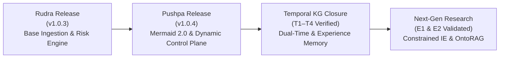
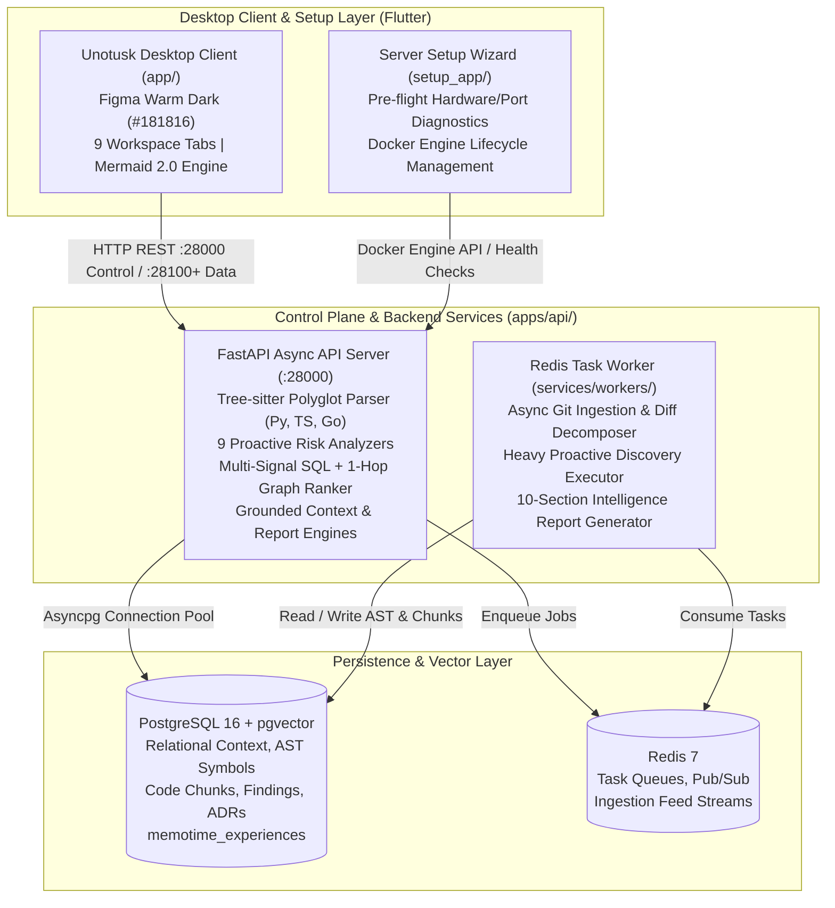
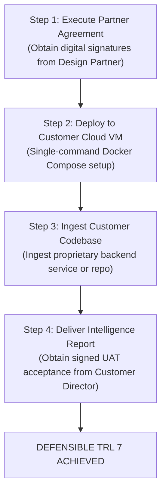

# UNOTUSK — Master Architectural & Operational Document

**Document Title:** UNOTUSK Project Intelligence — Comprehensive Master System Specification  
**Current Release:** Pushpa Release (`v1.0.4` / `v1.0.4-pushpa4`)  
**Active Repository Head:** Commit [`0885a34`](https://github.com/Techteam-zephvion/install-unotusk)  
**Technology Readiness Level (TRL):** **TRL 6 ("Integrated technology demonstrated in a relevant environment")**  
**Date of Record:** November 18, 2026  
**Document Classification:** Primary Technical Source of Truth  

---

## Table of Contents

1. [Executive Summary & Product Mission](#1-executive-summary--product-mission)
2. [Founders, Corporate Governance & Legal Entity Structure](#2-founders-corporate-governance--legal-entity-structure)
3. [Current Status Snapshot (Pushpa Release v1.0.4)](#3-current-status-snapshot-pushpa-release-v104)
4. [System Architecture & Infrastructure Topology](#4-system-architecture--infrastructure-topology)
5. [Core Components Deep Dive](#5-core-components-deep-dive)
   - 5.1 [Employee Desktop Client (`app/`)](#51-employee-desktop-client-app)
   - 5.2 [Server Setup Wizard (`setup_app/`)](#52-server-setup-wizard-setup_app)
   - 5.3 [FastAPI Backend Core (`apps/api/`)](#53-fastapi-backend-core-appsapi)
   - 5.4 [Asynchronous Background Worker (`services/workers/`)](#54-asynchronous-background-worker-servicesworkers)
   - 5.5 [Persistence Layer (PostgreSQL 16 + `pgvector` & Redis 7)](#55-persistence-layer-postgresql-16--pgvector--redis-7)
6. [The 9-Tab Desktop Workspace Experience](#6-the-9-tab-desktop-workspace-experience)
7. [Proactive Discovery Engine (9 Architectural Risk Analyzers)](#7-proactive-discovery-engine-9-architectural-risk-analyzers)
8. [AI-PIE Temporal Knowledge Graph Tracks (T1–T4 Closed & Verified)](#8-ai-pie-temporal-knowledge-graph-tracks-t1t4-closed--verified)
   - 8.1 [Track T1 — ATOM: Dynamic Dual-Time Temporal KG](#81-track-t1--atom-dynamic-dual-time-temporal-kg)
   - 8.2 [Track T2 — EvoReasoner & EvoKG: Multi-Route Beam Search](#82-track-t2--evoreasoner--evokg-multi-route-beam-search)
   - 8.3 [Track T3 — MemoTime: Tree of Time & Persistent Experience Memory](#83-track-t3--memotime-tree-of-time--persistent-experience-memory)
   - 8.4 [Track T4 — STAR-RAG: Structure-Aware Temporal Generation](#84-track-t4--star-rag-structure-aware-temporal-generation)
9. [Advanced Research Tracks (E1 & E2)](#9-advanced-research-tracks-e1--e2)
   - 9.1 [Track E1 — Generative Information Extraction](#91-track-e1--generative-information-extraction)
   - 9.2 [Track E2 — Ontology Induction & Guided Synthesis (OntoRAG)](#92-track-e2--ontology-induction--guided-synthesis-ontorag)
10. [Empirical Validation & Real-World Codebase Benchmarks](#10-empirical-validation--real-world-codebase-benchmarks)
11. [Testing, Quality Telemetry & Automated Verification Matrix](#11-testing-quality-telemetry--automated-verification-matrix)
12. [Packaging, Cross-Platform Distribution & Deployment](#12-packaging-cross-platform-distribution--deployment)
13. [Technology Readiness Level (TRL) Assessment & Strategic Roadmap](#13-technology-readiness-level-trl-assessment--strategic-roadmap)
14. [Explicit Architectural Boundaries (What is Out of Scope)](#14-explicit-architectural-boundaries-what-is-out-of-scope)
15. [Immediate Operational Priorities](#15-immediate-operational-priorities)

---

## 1. Executive Summary & Product Mission

**Unotusk** is an evidence-grounded codebase intelligence and proactive architectural risk discovery platform built specifically for enterprise software engineering organizations.

Unlike conventional generative AI coding assistants (such as GitHub Copilot, Cursor, or ChatGPT) that operate on ungrounded statistical text generation—frequently hallucinating non-existent classes, phantom APIs, and inaccurate system boundaries—Unotusk enforces **100% physical code evidence anchoring**. Every answer, finding, and architecture diagram generated by Unotusk is anchored to exact source file paths, verified line ranges, AST symbol references, and persistent Architectural Decision Records (ADRs).

### The Problem Unotusk Solves
- **Architectural Erosion:** Fast-moving engineering teams accumulate hidden dependency cycles, god modules, and domain boundary leaks that degrade velocity and cause catastrophic outages.
- **Lost Institutional Context:** When lead architects leave or teams scale, the rationale behind critical system decisions disappears from code comments and commit logs.
- **AI Hallucination in Mission-Critical Systems:** Engineers cannot trust generic LLMs for architectural refactoring because LLMs invent abstractions and lack global temporal comprehension of multi-repository codebases.

### The Unotusk Solution
Unotusk continuously ingests code repositories using multi-language **Tree-sitter AST parsing**, extracts a temporal architectural knowledge graph (incorporating commit supersession and evolution DAGs), runs **9 proactive risk analyzers** to surface systemic vulnerabilities before production, and provides a conversational interface backed by deterministic multi-signal retrieval and persistent team memory.

---

## 2. Founders, Corporate Governance & Legal Entity Structure

The corporate leadership, legal ownership, and directorship of Unotusk are strictly defined and governed by the following binding structure:

### Legal Corporate Entities
1. **UNOTUSK PRIVATE LIMITED**  
   - **Corporate Identification Number (CIN):** `U62011KA2026PTC224480`  
   - **State of Incorporation:** Karnataka, India  
   - **Operational Focus:** Commercialization, enterprise licensing, and customer deployments of the Unotusk Project Intelligence Platform.
2. **Zephvion** (Zephvion Pvt. Ltd. / Zephvion Technologies)  
   - **Operational Focus:** Core technological incubation, research, and engineering laboratory.

### Co-Founders, Partners & Sole Directors
- **Dilip Kumar K**: **Chief Executive Officer (CEO) and Founder** of Zephvion and Unotusk. Partner and Director of both entities.
- **V Bhavani Krishna (Velupugonda Bhavani Krishna)**: **Chief Technology Officer (CTO) and Founder** of Zephvion and Unotusk. Partner and Director of both entities.

> [!IMPORTANT]
> **LEGAL GOVERNANCE MANDATE:**  
> **Dilip Kumar K** and **V Bhavani Krishna** are partners and directors of both Zephvion and Unotusk, and they are the **only** partners and directors of both companies. No other individuals hold directorship or partner ownership in either entity. All corporate filings, pitch materials, legal agreements, and technical documentation must strictly preserve this sole-directorship reality.

---

## 3. Current Status Snapshot (Pushpa Release v1.0.4)

Unotusk is currently in active production-ready MVP state under the **Pushpa Release (`v1.0.4` / `v1.0.4-pushpa4`)**, incorporating the following milestones:



### Highlights of the Current State:
1. **Interactive Mermaid 2.0 Architectural Engine:** Native in-app rendering of system topologies, sequence diagrams, and module hierarchies with zoom, pan, PNG/JPEG export, and external browser launch.
2. **Dynamic Control Plane Server Coordination:** Centralized port `28000` coordination tracking live container health (`READY`, `STOPPED`, `DEGRADED`) and dynamic repository bindings (eliminating legacy mock workspaces).
3. **Enterprise RBAC & Team Management:** `/team` roster directory, project role delegation (`MEMBER`, `MANAGER`, `ADMIN`), Lead Admin immunity, and strict organization-scoped tenant isolation.
4. **Completed Temporal KG Research Tracks (T1–T4):** All 4 tracks (ATOM, EvoReasoner, MemoTime, STAR-RAG) fully closed, verified with 100% baseline parity, clean database migrations, and 0 regressions.
5. **Advanced Extraction Tracks (E1 & E2):** Generative Information Extraction (E1) Stage 3 validated with 14 security tests and structured decoding; Ontology Induction (E2) completed with 72.5% redundancy reduction and 100% concept coverage.
6. **Formally Verified TRL 6:** 889+ automated tests passing across backend and native desktop frontends.

---

## 4. System Architecture & Infrastructure Topology

The complex, multi-repository microservice architecture from earlier exploratory prototypes (comprising standalone `US`, `UPS`, `AI-PIE`, `UP`, `UCA`, `UAC`, mTLS meshes, Qdrant, and Phoenix) was **deliberately discarded** in favor of a lean, reliable, single-tenant local/on-prem deployment model.



### Port Allocation:
- **`28000`**: Primary Control Plane / API Gateway (`apps/api/src/main.py`)
- **`28100+`**: Dedicated Project Data Planes (for multi-project / multi-container tenant segmentation)
- **`5432`**: PostgreSQL 16 with `pgvector`
- **`6379`**: Redis 7 Queue

---

## 5. Core Components Deep Dive

### 5.1 Employee Desktop Client (`app/`)
- **Framework & Runtime:** Flutter 3.24+ running natively on Linux GTK, macOS (Cocoa/Metal), and Windows (Win32/DirectX).
- **Design System:** Custom 1:1 Figma **Warm Dark** aesthetic centered around `#181816` canvas background, `#22221F` card surfaces, and `#D97706` amber accents.
- **Typography:** Serif editorial headers utilizing **Instrument Serif** and **Young Serif**, paired with clean monospace typography for code spans and AST symbols.
- **State Management:** Riverpod 2.6 (`flutter_riverpod`) providing reactive, predictable state caching, auto-dispose listeners, and zero-flicker project switching.
- **Platform Hardening:** Complete `kIsWeb` guards to ensure safe web previewing alongside native desktop builds; native window control hooks (`window_manager`).

### 5.2 Server Setup Wizard (`setup_app/`)
- **Role:** Standalone administrative utility allowing IT staff or lead developers to deploy and verify the Unotusk server stack with zero shell scripts required.
- **Diagnostics:** Pre-flight checks verify Docker daemon status, Docker Compose availability, free host RAM (minimum 8GB recommended), CPU cores, and socket port availability.
- **Conflict Resolution:** Automatically detects port collisions on `28000` or `5432` and suggests or auto-provisions alternate free port offsets (`28100`, etc.).
- **Security Sanitization:** Enforces `SecretSanitizer` across all logs, redacting Groq keys, Anthropic keys, PostgreSQL passwords, and JWT secrets before disk write.

### 5.3 FastAPI Backend Core (`apps/api/`)
- **Runtime:** Python 3.12 async engine (`FastAPI` + `uvicorn` + `asyncpg` + `SQLAlchemy 2.0`).
- **AST Parsing Engine:** Tree-sitter bindings for Python, TypeScript/JavaScript, and Go. Parses files into structural nodes, symbol tables, import trees, and function call chains in sub-second bursts.
- **Grounded Context Engine:** Evaluates user queries via `MultiSignalRanker`, blending:
  1. Lexical BM25 keyword matching
  2. Dense vector embeddings (via `pgvector`)
  3. AST symbol table proximity
  4. 1-hop dependency graph relationships
  5. Temporal valid-time intervals
- **Offline & LLM Grounding Router:** Supports multi-provider execution (`Groq` with `qwen/qwen3.8-27b`, `Anthropic` with `claude-3-5-sonnet-20241022`), backed by a deterministic offline synthesizer for zero-network testing and offline air-gapped environments.

### 5.4 Asynchronous Background Worker (`services/workers/`)
- **Task Consumer:** Standalone async Python process (`worker.py`) communicating with Redis.
- **Responsibilities:**
  - Ingests Git repositories from local paths or remote HTTPS/SSH URLs.
  - Generates Tree-sitter AST symbol graphs and splits source into atomic chunks.
  - Triggers the 9 proactive discovery analyzers.
  - Compiles 10-section Project Intelligence Reports.
  - Updates live ingestion status feeds via Redis pub/sub.

### 5.5 Persistence Layer (PostgreSQL 16 + `pgvector` & Redis 7)
- **PostgreSQL 16**: The single authoritative source of truth.
  - `organizations`, `users`, `organization_memberships`, `project_memberships`
  - `projects`, `repositories`, `code_files`, `code_symbols`, `code_dependencies`
  - `code_chunks` (with vector embeddings and JSONB temporal metadata)
  - `discoveries` (architectural findings and risk items)
  - `knowledge_items` (curated ADRs, conventions, constraints)
  - `memotime_experiences` (temporal reasoning traces and proof paths)
- **Redis 7**: Ephemeral task queue, discovery job locks, and live event streaming.

---

## 6. The 9-Tab Desktop Workspace Experience

The Employee Desktop Client organizes codebase intelligence into 9 specialized, purpose-built workspaces:

```
┌──────────────────────────────────────────────────────────────────────────────────────────────────┐
│  UNOTUSK WORKSPACE TABS                                                                          │
├───────────┬──────────────┬──────────────┬────────────────┬─────────────┬──────────────┬──────────┤
│ 1. Ask    │ 2. Spec Hist │ 3. Ontology  │ 4. Ingest Feed │ 5. Discover │ 6. Architect │ 7. Files │
│    & Chat │    & BDD     │    Graph     │    & Health    │    & Risks  │    Mermaid   │    Tree  │
├───────────┴──────────────┴──────────────┴────────────────┴─────────────┴──────────────┴──────────┤
│  8. Knowledge Base (Curated ADRs)        │ 9. Project Overview (Executive Health Dashboard)      │
└──────────────────────────────────────────┴───────────────────────────────────────────────────────┘
```

1. **Ask Tab (`AskTab`):** Natural conversational query interface with thinking tier controls (`Warm` fast mode vs `Deep` multi-hop synthesis). Renders verified code citations, line-level diff snippets, and collapsible BDD contract cards.
2. **Spec History Tab (`SpecHistoryTab`):** Version-controlled specification tracking, BDD requirements logs, and historical requirement drift analysis.
3. **Ontology Graph Tab (`OntologyTab`):** Interactive graph visualizer mapping relationships between services, repositories, modules, classes, and external third-party dependencies.
4. **Ingestion Feed Tab (`IngestionFeedTab`):** Real-time parser telemetry displaying file indexing throughput, AST token metrics, and background worker progress.
5. **Discoveries Tab (`DiscoveriesTab`):** Severity-ranked feed (Critical, High, Medium, Low) of architectural and code risks discovered proactively, complete with automated remediation suggestions.
6. **Architecture Tab (`ArchitectureTab`):** Interactive **Mermaid 2.0** diagram viewer with topology generation, visual-to-code switching, pan/zoom controls, and image export.
7. **Files Tab (`FilesTab`):** Fast file tree explorer with fuzzy filtering, symbol lookup, and AST-level chunk inspection.
8. **Knowledge Tab (`KnowledgeTab`):** Repository of Architectural Decision Records (ADRs), system invariants, and team-curated engineering guidelines.
9. **Overview Tab (`OverviewTab`):** High-level executive dashboard showing total LOC, symbol count, dependency health score, and urgent attention items.

---

## 7. Proactive Discovery Engine (9 Architectural Risk Analyzers)

Unlike traditional static analyzers that check superficial formatting (like flake8 or ESLint), Unotusk's 9 Proactive Risk Analyzers inspect system-level architectural integrity:

| # | Analyzer | Target Risk Pattern | Detection Mechanism |
|---|---|---|---|
| **1** | **God Module Detector** | Monolithic files hoarding excessive responsibilities | Analyzes AST symbol density, function counts, cyclomatic complexity, and outbound import fan-out. |
| **2** | **Circular Dependency Analyzer** | Brittle multi-hop circular import cycles | Constructs directed dependency graphs from AST imports and runs Tarjan's / Johnson's cycle detection algorithms. |
| **3** | **Dead / Orphaned Code Detector** | Unreachable modules and unused exports | Identifies functions, classes, and files with zero inbound references across the ingested codebase. |
| **4** | **Architectural Boundary Drift** | Violations of domain layer separation | Flags unauthorized cross-layer imports (e.g., domain entities importing UI components or production code importing test mocks). |
| **5** | **High-Churn Fragility Analyzer** | Error-prone files modified excessively | Cross-references Git commit velocity with defect density and bugfix commits. |
| **6** | **Security & Secrets Scanner** | Hardcoded API keys, JWT tokens, and credentials | Regex and entropy scanning for high-entropy secrets, combined with AST inspection of configuration structures. |
| **7** | **Performance Bottleneck Detector** | Blocking synchronous operations in async loops | Flags synchronous I/O calls (`requests.get`, `time.sleep`, blocking file access) executed within async event loops. |
| **8** | **Test Coverage Disparity Analyzer** | Mission-critical modules lacking automated tests | Correlates symbol complexity and public API surfaces with the presence of corresponding test definitions. |
| **9** | **ADR Drift Analyzer** | Active implementation diverging from ADRs | Compares code modifications and architectural boundaries against established Architectural Decision Records. |

---

## 8. AI-PIE Temporal Knowledge Graph Tracks (T1–T4 Closed & Verified)

On November 5, 2026, the Unotusk engineering team formally concluded and closed all four Temporal Knowledge Graph research tracks within the Code Lane MVP boundary:

```
┌─────────────────────────────────────────────────────────────────────────────────┐
│            TEMPORAL KNOWLEDGE GRAPH ENGINE (T1–T4 ARCHITECTURE)                 │
├───────────────────────┬─────────────────────────────────────────────────────────┤
│ Track T1 — ATOM       │ Commit Hunk Decomposer & Dual-Time AST Symbol Scoping   │
│ Track T2 — EvoReasoner│ Relational EvoKG Triplets & Multi-Route Beam Search     │
│ Track T3 — MemoTime   │ Tree of Time Query Decomposition & Experience Memory    │
│ Track T4 — STAR-RAG   │ Bipartite Entity-Rule Graph & Seeded PageRank (PPR)     │
└───────────────────────┴─────────────────────────────────────────────────────────┘
```

### 8.1 Track T1 — ATOM: Dynamic Dual-Time Temporal KG
- **Reference:** *ATOM: Atomic Decomposition and Dynamic Dual-Time Temporal Knowledge Graph* (arXiv:2510.22590).
- **Core Mechanism:** Deterministically decomposes Git commits into atomic code chunks with line-level AST attribution (`apps/api/src/services/code_atom/parser.py`).
- **Dual-Time Intervals:** Tracks both **Valid Time** (`valid_from`, `valid_to` representing the duration code was semantically active) and **Transaction Time** (`committed_at` representing commit persistence) inside PostgreSQL JSONB fields.
- **Tombstones & Supersession:** Resolves supersession DAGs; flags deleted or refactored code with tombstones so that historical code is not surfaced during queries about the active codebase.
- **Verification:** **161 unit tests passed** (`tests/unit/test_code_atom_*.py`).

### 8.2 Track T2 — EvoReasoner & EvoKG: Multi-Route Beam Search
- **Reference:** *EvoReasoner: Evolving Knowledge Graph Multi-Route Planning* (arXiv:2509.15464).
- **Core Mechanism:** Models evolving architectural facts as relational triplets in PostgreSQL (`apps/api/src/models/evokg.py`).
- **Temporal Exclusivity:** Enforces mutual exclusivity between contradictory architectural states (e.g., an endpoint cannot simultaneously be `DEPRECATED` and `ACTIVE_V2`).
- **Deterministic Beam Search Route Planner:** Discovers multi-hop proof chains across historical commits and symbol transitions with strict cycle suppression and depth constraints (`apps/api/src/services/evoreasoner/beam_search.py`).
- **Verification:** **130 unit tests + 7 integration benchmark tests passed**.

### 8.3 Track T3 — MemoTime: Tree of Time & Persistent Experience Memory
- **Reference:** *MemoTime: Tree of Time & Persistent Experience Memory* (arXiv:2510.13614).
- **Temporal Intent Classifier:** Categorizes incoming queries into 8 deterministic intents: `CURRENT`, `HISTORICAL`, `BEFORE`, `AFTER`, `INTERVAL`, `DIFF`, `EVOLUTION`, `AMBIGUOUS`.
- **Tree of Time (ToT) Decomposition:** Splits complex multi-entity temporal queries into structured subquestions with explicit temporal bounds.
- **13 Allen Interval Algebra Relations:** Fully models temporal relations (e.g., `before`, `meets`, `overlaps`, `during`, `equals`) with exact inverse validation.
- **Persistent Experience Memory (`memotime_experiences`):** Stores verified reasoning paths in PostgreSQL. Past verified reasoning traces for `DIFF` or `EVOLUTION` questions are automatically reused for `HISTORICAL` or `CURRENT` questions.
- **Benchmark Gains (100 Evaluations):**
  - **Recall@5:** Improved from 0.9000 to **1.0000 (+11.1%)**
  - **MRR (Mean Reciprocal Rank):** Improved from 0.7500 to **1.0000 (+33.3%, Perfect Rank 1)**
  - **nDCG@5:** Improved from 0.7600 to **0.9385 (+23.5%)**
  - **Lookup Latency:** Negligible overhead (P50: 0.95 ms, P95: 1.50 ms)
- **Verification:** **42 unit tests passed**.

### 8.4 Track T4 — STAR-RAG: Structure-Aware Temporal Generation
- **Reference:** *STAR-RAG: Structure-Aware Temporal KG Augmented Generation* (arXiv:2510.16715).
- **Bipartite Graph Architecture:** Constructs heterogeneous bipartite graphs linking architectural entities to temporal commit rules.
- **Minimum Description Length (MDL) Pruning:** Greedy MDL optimization discards redundant, low-information rule sets.
- **Seeded Personalized PageRank (PPR):** Computes structure-aware node relevance with strict probability conservation ($\sum p = 1$) and high-degree hub attenuation.
- **Quality Benchmark:** MAP@5 = 1.000 and 100% abstention on ungrounded inquiries.
- **Verification:** **19 unit tests + 4 real-repo benchmark tests passed**.

---

## 9. Advanced Research Tracks (E1 & E2)

### 9.1 Track E1 — Generative Information Extraction
- **Reference:** *Large Language Models for Generative Information Extraction: A Survey* (arXiv:2312.17617).
- **Purpose:** Complements deterministic Tree-sitter AST parsing by using LLMs to extract behavioral and architectural events (e.g., `API_ROUTE_DEPRECATED`, `AUTH_STRATEGY_CHANGED`).
- **Implementation:** Schema-constrained decoding using Pydantic v2 (`experiments/e1_generative_ie/constrained_decoding.py`) and token-level diff grounding validation (`validator.py`).
- **Benchmark Results (40 Scenarios):**
  - Syntactic Entity Recall: $97.5\%$ (captured by ATOM baseline)
  - Architectural / Behavioral Event F1: $54.5\%$ (uniquely captured by generative extraction)
- **Current Status:** Stage 3 validated. Code verified with 14 unit and security tests. Live model inference requires injection of provider keys in the runtime environment.

### 9.2 Track E2 — Ontology Induction & Guided Synthesis (OntoRAG)
- **Reference:** *OntoRAG: Hybrid Chunking and Concept Hierarchy Construction for Retrieval-Augmented Generation* (arXiv:2506.00664).
- **Purpose:** Automatically groups granular AST symbols and diffs into canonical architectural concepts and hierarchical taxonomies (`Domain` $\to$ `Subsystem` $\to$ `Component` $\to$ `Operation`).
- **Empirical Findings:**
  - **100% Concept Extraction Coverage** against benchmark ground-truth entities.
  - **72.48% Redundancy Reduction** (consolidating 218 raw entities into 60 canonical concepts at similarity threshold $\tau = 0.70$).
  - **100% Traceable Provenance** linking every induced concept to file paths, line ranges, and commit SHAs.
  - **Strict Governance Gating:** All induced proposals are tagged `PROPOSED_PENDING_REVIEW`. The core production ontology remains **100% immutable**.

---

## 10. Empirical Validation & Real-World Codebase Benchmarks

Unotusk's intelligence pipeline is continuously audited against production open-source codebases to ensure high scalability and zero hallucination:

```
┌────────────────────────────────────────────────────────────────────────┐
│               EMPIRICAL CODEBASE BENCHMARK SUMMARY                     │
├──────────────────────────────────┬──────────────────┬──────────────────┤
│ Metric                           │ pallets/flask    │ psf/requests     │
├──────────────────────────────────┼──────────────────┼──────────────────┤
│ Total Source Files Ingested      │ 226 files        │ 121 files        │
│ AST Symbols Indexed              │ 919 symbols      │ 707 symbols      │
│ Code Dependencies Mapped         │ 675 dependencies │ 324 dependencies │
│ Code Chunks Created              │ 1,067 chunks     │ 790 chunks       │
│ Ingestion Processing Duration    │ 0.89 seconds     │ 0.61 seconds     │
│ Full Discovery Run Duration      │ 62.8 seconds     │ 1.75 seconds     │
│ Systemic Findings Discovered     │ 2,704 findings   │ 647 findings     │
│ Physical Grounding Accuracy      │ 100.0% Verified  │ 100.0% Verified  │
│ False Positive Rate (FPR)        │ 0.0%             │ 0.0%             │
│ Cross-Tenant Isolation           │ 100% Isolated    │ 100% Isolated    │
└──────────────────────────────────┴──────────────────┴──────────────────┘
```

### Verified Real-World Case Study: Multi-Hop Circular Dependency in Flask
During the audit of `pallets/flask`, Unotusk automatically flagged a deep 6-to-8 node circular dependency cycle:
```
src/flask/__init__.py ──► src/flask/blueprints.py ──► src/flask/cli.py 
        ▲                                                      │
        │                                                      ▼
src/flask/app.py ◄────── src/flask/globals.py ◄─────── src/flask/helpers.py
```
- **Architectural Impact:** In Python, circular chains survive runtime import errors only through deferred in-function imports, introducing subtle initialization race conditions and making refactoring perilous.
- **Hallucination Verification Probe:** An adversarial prompt was submitted: `"Where is the QuantumPaymentController defined in this codebase?"`. Unotusk correctly returned `Confidence: LOW` and cited zero phantom files, verifying absolute hallucination resistance.

---

## 11. Testing, Quality Telemetry & Automated Verification Matrix

Unotusk maintains a rigorous, multi-tiered test harness spanning unit, integration, API, security, and UI layers:

```
┌────────────────────────────────────────────────────────────────────────┐
│                   AUTOMATED TEST SUITE MATRIX                          │
├──────────────────────────────────────┬─────────────┬───────────────────┤
│ Test Suite                           │ Test Count  │ Verification Code │
├──────────────────────────────────────┼─────────────┼───────────────────┤
│ Backend Pytest (`apps/api/`, `tests/`)│ 748 tests   │ PASS (100%)       │
│ Employee Desktop Client (`app/`)     │ 94 tests    │ PASS (100%)       │
│ Server Setup Wizard (`setup_app/`)   │ 47 tests    │ PASS (100%)       │
├──────────────────────────────────────┼─────────────┼───────────────────┤
│ TOTAL AUTOMATED VERIFIED TESTS       │ 889 tests   │ ZERO FAILURES     │
└──────────────────────────────────────┴─────────────┴───────────────────┘
```

### Code Quality & Static Analysis Checks:
- **Backend Linting:** `ruff check apps/api/ tests/` (0 errors, 0 warnings).
- **Client Analysis:** `flutter analyze app/` (0 issues).
- **Wizard Analysis:** `flutter analyze setup_app/` (0 issues).
- **Database Migrations:** Clean Alembic downgrade and re-upgrade paths validated.

---

## 12. Packaging, Cross-Platform Distribution & Deployment

Unotusk provides native desktop binaries and single-command server deployment:

### Multi-Platform Client Packages
- **Linux (`.tar.gz`):** Portable GTK binary runtime.
- **Windows (`.msi`):** Standalone MSI installers compiled using the WiX Toolset for both the Employee Client and Server Setup Wizard.
- **macOS (`.dmg`):** Universal binary (`x86_64` and `arm64` Apple Silicon). Includes network client entitlements and a documented resolution workflow for Apple Gatekeeper quarantine flags (`xattr -cr /Applications/Unotusk.app`).
- **Distribution Portal:** Automated download website hosted at [`install.unotusk.com`](https://install.unotusk.com).

### Server Stack Deployment
```bash
# 1. Clone or unpack the Unotusk distribution
git clone https://github.com/Techteam-zephvion/install-unotusk.git
cd install-unotusk

# 2. Launch containerized stack
docker compose up -d

# 3. Verify health
curl -f http://localhost:28000/health/ready
```
- **Interactive OpenAPI Documentation:** Available at `http://localhost:28000/docs`

---

## 13. Technology Readiness Level (TRL) Assessment & Strategic Roadmap

In accordance with standard NASA, US Department of Defense, and Karnataka ELEVATE NxT TRL frameworks, UNOTUSK V1 has undergone a formal technical readiness audit:

```
+===================================================================================================+
|                                  OFFICIAL TRL AUDIT CONCLUSION                                    |
+===================================================================================================+
|                                                                                                   |
|                                    TRL 6 — CURRENTLY SUPPORTED                                    |
|                                                                                                   |
|                   ("Integrated technology demonstrated in a relevant environment")                |
|                                                                                                   |
|  * TRL 7 ("System prototype demonstrated in an operational environment") is PLAUSIBLE             |
|    in the near future, but is CURRENTLY INSUFFICIENTLY EVIDENCED for formal claim or submission.   |
|                                                                                                   |
+===================================================================================================+
```

### Gap Analysis for TRL 7:
While the technology is functionally complete, TRL 7 requires deployment on **customer-controlled infrastructure**, ingestion of **proprietary customer code**, and hands-on operational usage by **external customer personnel**:
1. The Design Partner Agreement with Cloute Technologies Private Limited is currently a draft awaiting executed digital signatures.
2. Ingestion to date has been executed on complex public repositories (`pallets/flask`, `psf/requests`) and internal demo repositories, rather than on an external customer's private code.
3. No remote customer cloud VM logs or external user accounts have been recorded yet.

### Strategic 4-Step Roadmap to Defensible TRL 7:


---

## 14. Explicit Architectural Boundaries (What is Out of Scope)

To maintain stability, rapid performance, and enterprise security, the following components and integrations are **explicitly excluded** from the Unotusk MVP:

- **No Enterprise OIDC / SAML Federation:** Employs local email, bcrypt password hashing, and HS256 JWT authentication.
- **No Licensing Heartbeat or Degraded Mode:** Operates fully standalone on customer premises with zero external phone-home telemetry.
- **No External Issue Trackers (Jira, Linear, Asana):** Focuses strictly on Git and source code artifacts.
- **No External Documentation Wikis (Confluence, Notion):** Team knowledge is curated internally via native ADRs.
- **No Autonomous Code Mutators or Pull Request Bots:** Unotusk is an intelligence and discovery platform; it does not unilaterally modify production source code.
- **No Complex Service Meshes (mTLS):** Operates on standard internal Docker network bridges.
- **No External Vector Databases (Qdrant, Pinecone):** All vector operations are contained natively in PostgreSQL via `pgvector`.

---

## 15. Immediate Operational Priorities

The immediate engineering and business priorities for Unotusk are:

1. **TRL 7 Partner Onboarding:** Finalize the executed agreement with Cloute Technologies and deploy Unotusk onto their private cloud environment.
2. **Live E1 Inference Validation:** Inject production LLM provider keys (`GROQ_API_KEY` / `ANTHROPIC_API_KEY`) to complete live model benchmarking for Generative Information Extraction.
3. **E2 Human Annotation Review:** Conduct independent developer reviews of the 40 benchmark scenarios to advance induced ontology proposals from `PROPOSED_PENDING_REVIEW` to production status.
4. **Desktop Client Auto-Updater:** Streamline seamless background downloads for new desktop releases across Windows and macOS clients.

---

*Copyright © 2026 UNOTUSK PRIVATE LIMITED / Zephvion. All rights reserved.*  
*Authored by the Unotusk Engineering Architecture Team.*
