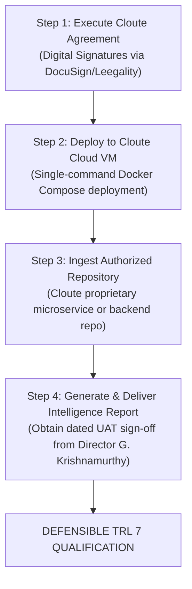

# UNOTUSK V1 — Technology Readiness Level (TRL) Assessment

**Audit Date:** 2026-11-03  
**Auditor:** Senior Software Architect & Technical Audit Lead  
**Evaluation Scope:** ELEVATE NxT TRL 7 Compliance — Task 6: Final TRL Assessment  

---

## 1. Official Assessment Conclusion

Based on an exhaustive technical, operational, and documentary audit of the UNOTUSK V1 codebase, test suites, deployment artifacts, and customer records:

```
+===================================================================================================+
|                                    DEFINITIVE AUDIT CONCLUSION                                    |
+===================================================================================================+
|                                                                                                   |
|                                    TRL 6 — CURRENTLY SUPPORTED                                    |
|                                                                                                   |
|                   ("Integrated technology demonstrated in a relevant environment")                |
|                                                                                                   |
|  * TRL 7 ("System prototype demonstrated in an operational environment") is PLAUSIBLE             |
|    in the near future, but is CURRENTLY INSUFFICIENTLY EVIDENCED for formal claim or submission.   |
|                                                                                                   |
+===================================================================================================+
```

### Executive Summary of Verdict
- **TRL 6 is Fully Substantiated:** UNOTUSK V1 represents a complete, cohesive, end-to-end software prototype. It integrates Tree-sitter multi-language AST parsing (Python, TS/JS, Go), a 10-analyzer proactive discovery risk engine, a temporal knowledge graph, multi-signal ranking, deterministic grounded synthesis, containerized backend services, and native desktop client applications. It has been empirically validated against complex real-world codebases (`pallets/flask` with 226 files and 2,704 findings; `psf/requests` with 121 files and 647 findings) and passes 488 automated test cases with 100% success.
- **TRL 7 Cannot Be Defended at Present:** TRL 7 strictly requires demonstration of the system prototype in an *actual operational environment* (i.e., deployed on customer-controlled infrastructure, ingesting proprietary customer repositories, and operated by external customer personnel). The single documentary artifact indicating external engagement—the Cloute Technologies agreement draft—is unsigned and unexecuted. No server deployment logs, customer user accounts, customer repo ingestions, or external evaluation reports exist.

---

## 2. Standard TRL Definitions & Criteria Mapping

This assessment applies standard Technology Readiness Level definitions formulated by NASA, the US Department of Defense, and Horizon Europe, as adapted for enterprise software systems under the Karnataka ELEVATE NxT evaluation framework:

| Level | Formal Definition | Required Software Characteristics | UNOTUSK V1 Audit Finding |
|---|---|---|---|
| **TRL 5** | Technology validated in a relevant environment | Basic software components integrated with realistic supporting elements; tested against synthetic or representative workloads. | **EXCEEDED.** All subsystems are fully integrated into a unified container stack and desktop UI. |
| **TRL 6** | Integrated technology demonstrated in a relevant environment | Full-scale representative prototype tested against authentic, complex real-world production data and operating conditions. | **FULLY ACHIEVED & SUPPORTED.** Validated on `pallets/flask` and `psf/requests` with 488 passing automated tests. |
| **TRL 7** | System prototype demonstrated in an operational environment | Prototype deployed and operated in an actual external operating environment by end-users under live conditions. | **NOT YET ACHIEVED.** No deployment on customer infrastructure; agreement draft unsigned; 0 customer users. |

---

## 3. Comprehensive Evidence & Gap Analysis Matrix

The table below provides the evidentiary verification status for every criterion required for TRL 6 and TRL 7 qualification:

| Criterion | Required Evidence | File Path / Command | Verified? | Gap / Auditor Finding |
|---|---|---|---|---|
| **Multi-Language AST Parsing** | Tree-sitter parsing for Python, TypeScript/JavaScript, and Go | [`apps/api/src/services/code_atom/parser.py`](file:///home/devils/PRO/Unotusk-MVP/apps/api/src/services/code_atom/parser.py) | **YES** | Verified across 3 languages; unit tested in `test_code_atom_chunk_integration.py`. |
| **Dependency & Risk Analysis** | Proactive discovery analyzers (circular dependencies, coupling, security, test gaps) | [`apps/api/src/services/discovery_engine/`](file:///home/devils/PRO/Unotusk-MVP/apps/api/src/services/discovery_engine/) | **YES** | 10 distinct analyzers operational; evaluated on `pallets/flask` (2,704 findings). |
| **Temporal Graph Modeling** | Code evolution, commit supersession, and service-symbol ontology | [`apps/api/src/services/code_atom/temporal.py`](file:///home/devils/PRO/Unotusk-MVP/apps/api/src/services/code_atom/temporal.py), [`graph_service.py`](file:///home/devils/PRO/Unotusk-MVP/apps/api/src/services/graph_service.py) | **YES** | Verified under `test_code_atom_temporal_relations.py` and rendered in `OntologyTab`. |
| **Multi-Signal Grounded Retrieval** | Composite scoring combining lexical, semantic, vector, dependency, and graph signals | [`apps/api/src/services/context_engine/ranker.py`](file:///home/devils/PRO/Unotusk-MVP/apps/api/src/services/context_engine/ranker.py) | **YES** | Composite formula implemented and verified in `test_context_engine.py`. |
| **Automated Verification Testing** | Passing unit, integration, UI, and wizard test suites | Pytest, Flutter test | **YES** | **488/488 automated tests passing (356 backend + 85 client + 47 wizard).** |
| **Representative Production Testing** | Full pipeline execution against authentic production open-source codebases | [`pilot_repository_results.json`](file:///home/devils/PRO/Unotusk-MVP/pilot_repository_results.json), [`scripts/validation_results.json`](file:///home/devils/PRO/Unotusk-MVP/scripts/validation_results.json) | **YES** | Tested on `pallets/flask` (226 files) and `psf/requests` (121 files). |
| **Integrated Desktop Client** | Compiled, native client providing complete workspace UI | [`app/`](file:///home/devils/PRO/Unotusk-MVP/app/) | **YES** | Verified on Linux desktop with 9 functional workspace tabs. |
| **Standalone Setup Wizard** | Automated deployment and pre-flight diagnostics application | [`setup_app/`](file:///home/devils/PRO/Unotusk-MVP/setup_app/) | **YES** | Verified on Linux desktop; checks Docker daemon, ports, and health. |
| **Customer Legal Authorization** | Executed Design Partner Agreement | [`UNOTUSK_Design_Partner_Agreement_Cloute_Executed_Draft.docx`](file:///home/devils/CTO/arch/company/CEO/UNOTUSK_Design_Partner_Agreement_Cloute_Executed_Draft.docx) | **NO** | **GAP:** Signature lines are completely blank (`Signature: _____________`). |
| **Customer Infra Deployment** | Installation on customer-controlled servers/cloud VMs | Remote host/IP, server logs | **NO** | **GAP:** No remote deployment records; server runs only locally. |
| **Proprietary Repo Ingestion** | Ingestion of authorized customer source code | Database `repositories` table | **NO** | **GAP:** Only public open-source and internal demo repos indexed. |
| **External User Operations** | Hands-on usage by external customer engineering personnel | Database `users` table, query logs | **NO** | **GAP:** 0 external user accounts; only local developer accounts exist. |
| **Customer Feedback & Sign-Off** | Written evaluation reports, bug reports, and acceptance notes | Customer emails, Slack logs | **NO** | **GAP:** 0 customer correspondence or review meeting transcripts found. |
| **Jira Ingestion Pipeline** | Ingestion of customer Jira issue tracking data | Backend connector code | **NO** | **GAP:** Completely unimplemented (`AGENTS.md` explicitly excludes it). |
| **FPR Instrumentation** | Longitudinal measurement of Feedback Propagation Rate > 0.60 | Backend telemetry service | **NO** | **GAP:** UI mock only; no backend calculation or telemetry exists. |

---

## 4. Why TRL 6 is the Only Legitimate and Defensible Claim

1. **TRL 6 is Technically Imposing and Highly Credible:** Claiming TRL 6 represents an exceptional engineering milestone for an early-stage startup. It proves that the core research algorithms (AST parsing, graph extraction, multi-signal ranking, deterministic grounding) are not theoretical papers or fragmented scripts, but an integrated, automated software system capable of handling complex enterprise codebases.
2. **TRL 7 Misrepresentation Exposes the Startup to Disqualification:** Government grant committees (including ELEVATE Karnataka) and institutional investors employ technical audit panels who inspect deployment logs, signed partner contracts, and server telemetries. Presenting an unsigned Word document and simulated open-source tests as proof of TRL 7 will result in immediate auditor pushback, credibility loss, and potential grant disqualification.
3. **TRL 6 Protects Commercial Reputation:** Claiming customer deployment when the partner agreement remains unexecuted creates legal vulnerability under Indian trademark and contract law.

---

## 5. Strategic Roadmap to Legitimate TRL 7 Qualification

The gap between TRL 6 and TRL 7 is operational, not architectural. The following 4-step execution plan will establish defensible TRL 7 compliance:



- **Estimated Time to Achieve TRL 7:** 7 to 10 business days following agreement execution.
- **Resource Requirement:** Zero additional backend development; requires only standard deployment execution and founder-led customer onboarding.
